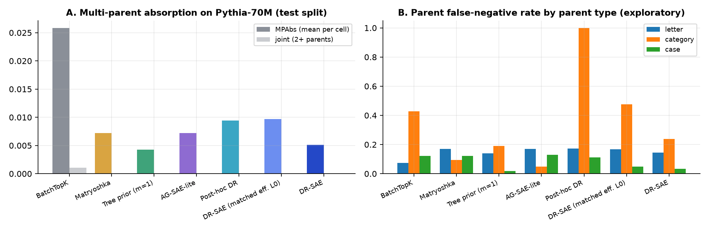
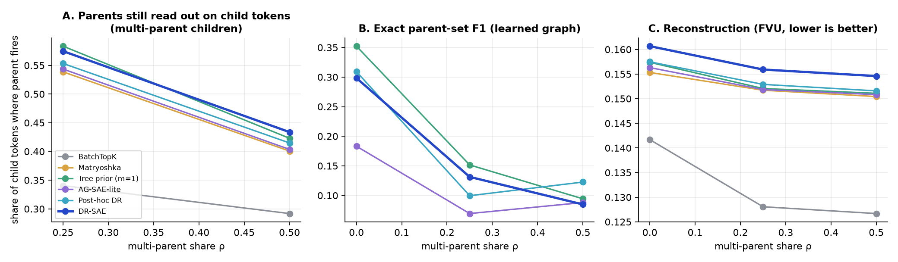
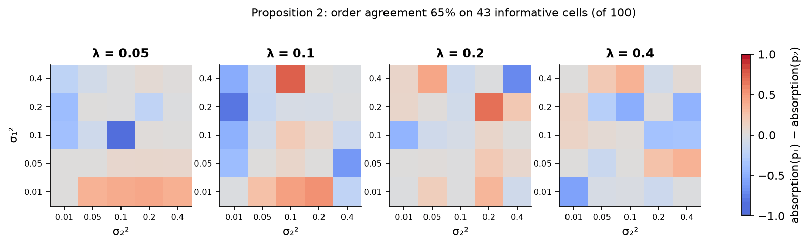
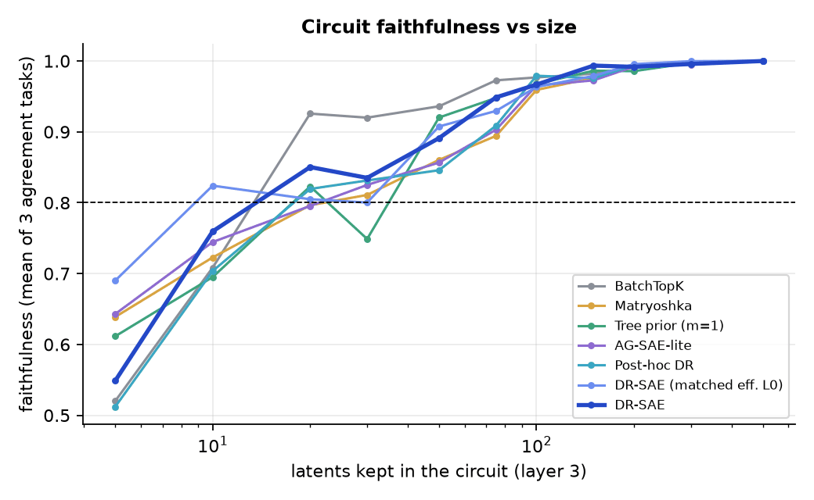
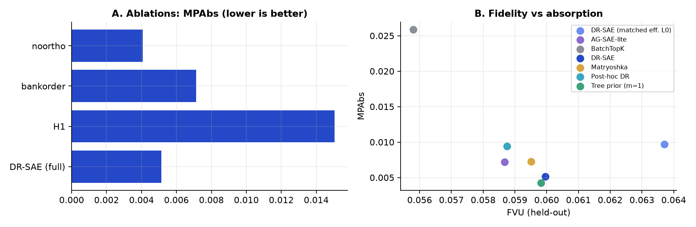

# TopoCircuit-SAE

**Measuring multi-parent feature absorption in sparse autoencoders, and testing whether frequency-ordered DAG routing reduces it.**

[](LICENSE)
[](.github/workflows/ci.yml)


**Author:** Muzra Fatima · AIML capstone, mechanistic interpretability · **License:** [MIT](LICENSE)

> Every number in this repository is produced by the code in it, from `configs/cpu_small.yaml`.
> An earlier version reported results that were never produced by running a model. They were
> withdrawn; [`docs/DEVIATIONS.md`](docs/DEVIATIONS.md) explains what changed and why.

---

## What this is

A **sparse autoencoder (SAE)** rewrites a language model's activation as a few active, readable
directions called *latents*. **Feature absorption** is when a specific latent ("bat") silently takes
over a general one ("animal"), so the general latent stops firing where it should. The sparsity
penalty causes it, because firing one latent is cheaper than firing two.

Every published absorption score uses the first-letter task, where each token has **one** parent.
Real concepts have several: " bat" starts with *B*, is an animal, and is lowercase. This project
contributes:

| | What | Where |
|---|---|---|
| **MPAbs** | An absorption benchmark with three parents per token (letter, WordNet category, case), scored per parent and jointly on real Pythia-70M activations | [`topocircuit/benchmarks/mpabs_lm.py`](topocircuit/benchmarks/mpabs_lm.py) |
| **DR-SAE** | An SAE that learns a parent graph between its latents, acyclic by construction (edges only run from more- to less-frequent latents), and routes each child's activation up to its ancestors: `z_eff = z + Az + A²z + …` | [`topocircuit/models/sae.py`](topocircuit/models/sae.py) |
| **Synthetic tier** | A generator with a known multi-parent ground-truth graph, and a test of Proposition 2 (which parent is absorbed first) | [`topocircuit/data/`](topocircuit/data/), [`topocircuit/eval/prop2.py`](topocircuit/eval/prop2.py) |
| **Circuit test** | How many SAE latents a subject-verb agreement circuit needs to keep 80% of the behaviour | [`topocircuit/eval/circuits_lm.py`](topocircuit/eval/circuits_lm.py) |

---

## Demo

An interactive explorer that reads only measured results (`demo/data/results.js`, generated by
`scripts/build_demo_data.py`).

| DAG hierarchy explorer | Routing simulator |
|:-:|:-:|
|  |  |
| The edges DR-SAE actually learned around the latents that best match each MPAbs parent probe, labelled by top-activating tokens. | A child's activation travelling up to its ancestors, hop by hop. |

| Leaderboard | Mobile layout |
|:-:|:-:|
|  |  |
| Every method's absorption, fidelity and circuit size, plus all 52 MPAbs cells. | The same pages at phone width. |

```bash
python scripts/serve_app.py            # then open http://127.0.0.1:8000
```

---

## Results

Pythia-70M-deduped, layer 3; seven SAEs of width 2,048 trained on the same 857,504 pile-10k tokens
for the same number of steps from a random init, seed 42. Native k = 32 except the matched run.

### Language model (MPAbs test split, 52 cells, 1,828 tokens)

| Method | MPAbs ↓ | Parent false negatives ↓ *(exploratory)* | FVU ↓ | Loss recovered ↑ | L0 native / effective | Circuit latents @ 0.8 ↓ |
|---|---|---|---|---|---|---|
| BatchTopK | 2.59% | 11.4% | 0.056 | 92.9% | 30.4 / 30.4 | 13.5 |
| Matryoshka | 0.72% | 13.1% | 0.060 | 92.5% | 30.2 / 30.2 | 38.3 |
| Tree prior (one parent) | 0.43% | 4.8% | 0.060 | 92.2% | 30.2 / 33.4 | 22.1 |
| AG-SAE-lite | 0.72% | 13.3% | 0.059 | 92.6% | 30.6 / 32.7 | 37.3 |
| Post-hoc DR | 0.94% | 13.7% | 0.059 | 92.5% | 30.5 / 37.6 | 38.0 |
| DR-SAE (matched effective L0) | 0.97% | 8.2% | 0.064 | 91.5% | 23.5 / 31.8 | 15.8 |
| **DR-SAE** | 0.51% | 6.2% | 0.060 | 92.1% | 30.0 / 38.1 | 20.8 |



### Pre-registered hypotheses

| | Hypothesis (thresholds from the blueprint) | Measured | Outcome |
|---|---|---|---|
| **H1** | Tree prior loses ≥ 20 pts of parent-set recall as ρ goes 0 → 0.5, DR-SAE ≤ 5; Prop. 2 order in ≥ 80% of cells | Tree −19.3 pts, DR-SAE −17.2 pts; Prop. 2 order 65% of 43 informative cells | Not supported |
| **H2** *(primary)* | DR-SAE cuts MPAbs ≥ 15% vs Matryoshka at matched effective L0, CI excluding 0 | −34% (95% CI −318% to +59%, p = 0.70) | Falsified; every MPAbs is below 3% (floor effect) |
| **H3** | Synthetic exact parent-set F1 ≥ 0.90; edges reproduce across seeds ≥ 60% and above the post-hoc baseline | F1 0.13; 7% vs 20% for AG-SAE-lite | Falsified |
| **H4** | ≥ 20% fewer circuit latents than BatchTopK and Matryoshka | 46% fewer than Matryoshka, 55% more than BatchTopK | Not supported |

**What did hold up (exploratory, added after results):** DR-SAE leaves a parent's latent silent
where its probe fires **37% less often** than Matryoshka at matched effective L0 (95% CI 20–54%) and
52% less at matched native L0. But a one-parent tree prior does better (64% less), so the gain comes
from routing, not from allowing several parents.

Full write-up: [`PREREGISTRATION.md`](PREREGISTRATION.md) and the paper source
[`paper/TopoCircuit_SAE_Paper.tex`](paper/TopoCircuit_SAE_Paper.tex).

### Synthetic ground truth





### Circuits and ablations





---

## Reproduce

Everything runs on a CPU (tested on 4 cores and 8 GB RAM, about 6 hours end to end).

```bash
python -m venv .venv && source .venv/bin/activate          # Windows: .venv\Scripts\activate
pip install torch --index-url https://download.pytorch.org/whl/cpu
pip install -e ".[research,dev]"
export HF_HOME=$PWD/.hf_cache NLTK_DATA=$PWD/.hf_cache/nltk_data

python scripts/extract_activations.py --layers 3        # cache Pythia-70M activations (data/, not in git)
python scripts/run_synthetic.py --steps 2000            # synthetic sweep + Proposition 2
python scripts/run_synthetic_repro.py                   # cross-seed edge reproducibility
python scripts/train_lm_saes.py --methods BatchTopK Matryoshka
bash   scripts/run_lm_queue.sh                          # other methods, ablations, then evaluation
python scripts/make_figures.py
python scripts/build_demo_data.py
python scripts/write_paper.py
```

Tests and lint (what CI runs):

```bash
pip install -r requirements.txt pytest ruff
ruff check . && ruff format --check . && python -m pytest
```

---

## Repository layout

```
configs/cpu_small.yaml        every setting used for the runs
docs/DEVIATIONS.md            what differs from the blueprint and why
topocircuit/
  models/                     BatchTopK, Matryoshka, DR-SAE; training loop; Post-hoc DR, AG-SAE-lite
  data/                       synthetic mixed-topology generator
  benchmarks/mpabs_lm.py      MPAbs on Pythia-70M
  eval/                       structure scoring, Proposition 2, circuits, statistics and gates
  server/                     local API + SQLite behind the explorer
scripts/                      every step above
results/                      all numbers (JSON) and figures
demo/                         explorer, generated data, screenshots
paper/                        LaTeX source generated from results
theory/                       Lemma 1 and Proposition 2 derivations
```

## Limitations

One seed on the language model; a 70M-parameter model with 2,048 latents and under 1M training
tokens; 52 MPAbs cells instead of the planned 100, and only 7 of 26 parent probes pass the
0.90 gate; single-layer circuits on three agreement templates; the tree prior and AG-SAE-lite are
reimplemented from paper descriptions. See [`docs/DEVIATIONS.md`](docs/DEVIATIONS.md).

## Acknowledgements

Builds on ideas and methods from SAELens and SAEBench (Karvonen et al.), SynthSAEBench (Chanin &
Garriga-Alonso), Sparse Feature Circuits (Marks et al.), Matryoshka SAEs (Bussmann et al.),
BatchTopK (Bussmann et al.; Gao et al.), "A is for Absorption" (Chanin et al.), the geometry of
hierarchical concepts (Park et al.), and AG-SAE (Shen et al.), which is the closest prior work and
is used as a baseline. Pythia models by EleutherAI; pile-10k by Neel Nanda; WordNet via NLTK.

## License

[MIT](LICENSE) © 2026 Muzra Fatima
