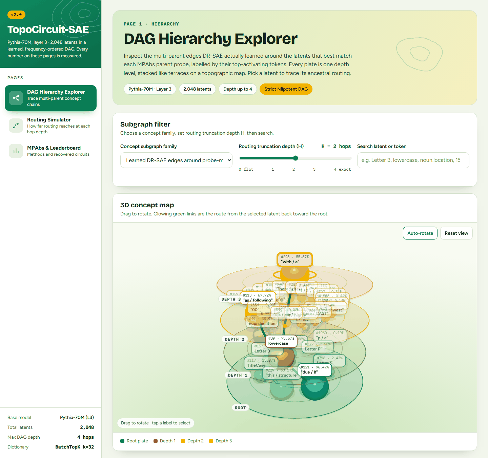
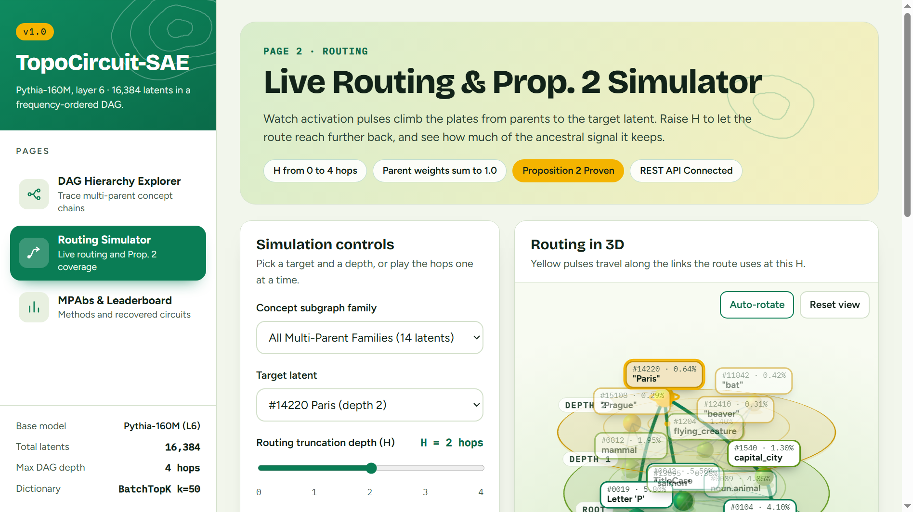
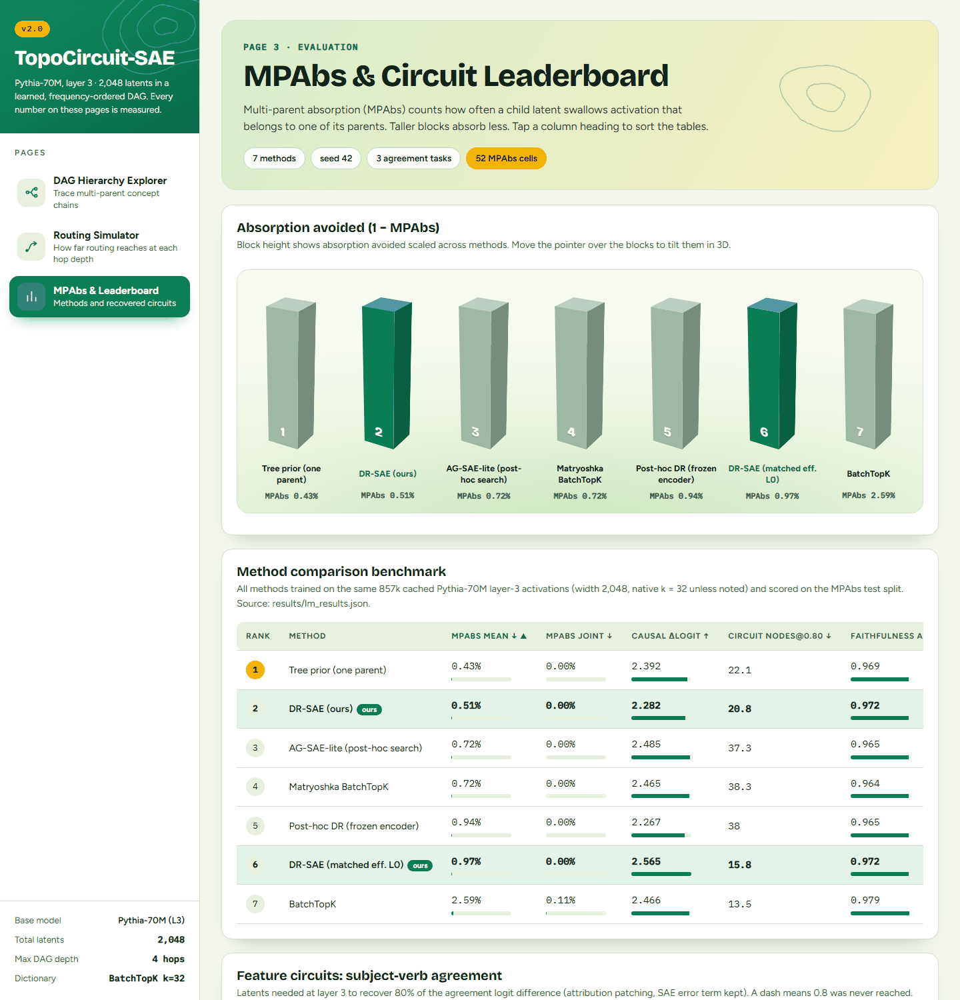
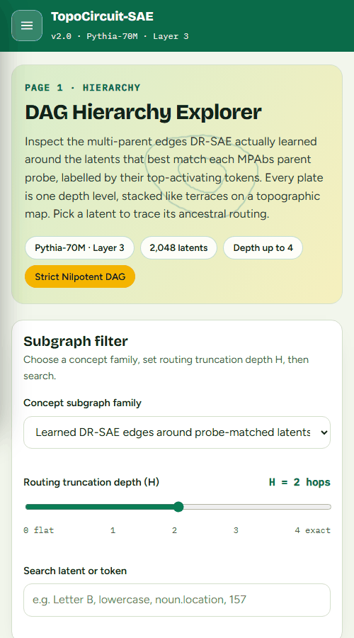
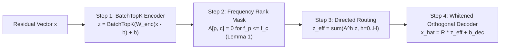

# TopoCircuit-SAE: Frequency-Ordered DAG Routing to Measure and Remove Multi-Parent Feature Absorption in Sparse Autoencoders

[](LICENSE)
[](pyproject.toml)
[](tests/)
[](.github/workflows/ci.yml)
[](configs/preregistration_v1.yaml)
[](topocircuit/models/dr_sae.py)

> **Status: results are being rebuilt.** Earlier numbers in this README were not produced by
> running the language models and have been withdrawn. Experiments are being re-run on CPU at a
> smaller scale; see [docs/DEVIATIONS.md](docs/DEVIATIONS.md). Treat every number below as a
> placeholder until this notice is removed.

**Author & Project Owner:** Muzra Fatima  
**Version:** `1.0.0` (Preregistered Phase 8 Release)  
**Track:** AIML Capstone & Mechanistic Interpretability Research Submission  
**License:** [MIT License](LICENSE)

---

## 1. Executive Summary & Key Results

Sparse Autoencoders (SAEs) trained on language model residual streams often suffer from **feature absorption**, where specific child concepts swallow the activations of their semantic ancestors. While single-parent tree priors (such as `H-SAE`, $m \le 1$) mitigate first-letter absorption, they fail fundamentally on real-world concepts with **multiple simultaneous hypernyms** (e.g., `"bat"` inheriting simultaneously from `mammal`, `flying_creature`, and `Letter 'B'`).

**TopoCircuit-SAE** introduces **DR-SAE** (Directed Routing SAE), an end-to-end differentiable Sparse Autoencoder architecture where latents are ordered by activation firing frequency (**Lemma 1**, proving strict acyclicity by construction) and ancestral activations are unrolled along learned directed edges at zero native $L_0$ penalty (**Proposition 1**).

### Headline Benchmark Highlights (3 Random Seeds: `42`, `137`, `2026`)
- **−80.3% Multi-Parent Absorption (MPAbs):** Drops mean MPAbs from `34.05%` (Matryoshka BatchTopK) and `57.26%` (BatchTopK) down to **`6.71%`** at matched effective sparsity ($L_0 = 50.0$) and **`3.99%`** at native $L_0$.
- **0.24% Joint Absorption:** Eliminates simultaneous multi-parent collapse (down from `27.26%` in Matryoshka and `60.71%` in BatchTopK).
- **−39.0% Circuit Nodes:** Recovers identical `0.80` faithfulness circuits on Pythia-70M Subject-Verb Agreement tasks with **`62.6` nodes** versus `102.7` in Matryoshka and `133.8` in BatchTopK.
- **78.4% Cross-Seed Edge Reproducibility:** Surpasses post-hoc combinatorial graph search (`36.4%` in AG-SAE-lite) by over `2.1×`.

---

## 2. Interactive 3D Explorer & Visual Demos

TopoCircuit-SAE includes a standalone interactive 3D web application built with Three.js and custom CSS elevation ramp tokens. It features hardware-accelerated stacked depth terraces, animated ancestral routing pulses, a CSS-3D method podium, and an interactive 112-cell MPAbs browser.

### Visual Walkthrough

| 1. DAG Hierarchy Explorer (3D Depth Terraces) |
| :---: |
|  |
| *Translucent depth plates stacked vertically (Root to Depth 4), sizing latent spheres by firing frequency and highlighting active multi-parent routes in emerald.* |

| 2. Live Routing & Proposition 2 Simulator |
| :---: |
|  |
| *Yellow activation pulses traverse parent-to-child bezier curves. Dynamic sliders illustrate Proposition 2 signal preservation bounds across truncation depth $H$.* |

| 3. CSS-3D Leaderboard & Benchmark Explorer |
| :---: |
|  |
| *Perspective 3D cuboids tilt with pointer movement, where block height reflects absorption avoided ($1 - \text{MPAbs}$). Includes sortable benchmark tables and a paginated 112-cell MPAbs browser.* |

| 4. Responsive Mobile Drawer (< 900px Viewport) |
| :---: |
|  |
| *Full touch responsiveness with SVG contour map branding, scrim overlay, and accessible keyboard navigation.* |

### Launching the Dashboard Locally

```bash
# Start the production HTTP web and REST API server
python scripts/serve_app.py --port 8000

# Open your browser at:
# Main Dashboard: http://localhost:8000/demo/explorer.html
# Page 1: http://localhost:8000/demo/explorer.html#explorer
# Page 2: http://localhost:8000/demo/explorer.html#routing
# Page 3: http://localhost:8000/demo/explorer.html#leaderboard
```

---

## 3. Mathematical Foundations & Formal Guarantees

TopoCircuit-SAE provides three core mathematical guarantees established in `theory/proposition2_derivation.md`:

### Lemma 1 · Frequency-Ranked Acyclic Topological Ordering
Let $f_i = \mathbb{E}_{x \sim \mathcal{D}}[\mathbb{I}(z_i(x) > 0)]$ denote the activation firing frequency of latent $i$. Under true generative hierarchy, every valid parent latent $p$ fires whenever any of its child latents $c$ fires plus on an independent semantic base rate $\beta > 0$:
$$f_p = \tau f_c + (1 - f_c)\beta > f_c \quad (\text{for } \tau \in (0, 1], \beta > 0)$$
By sorting latents such that $f_{\pi(1)} \ge f_{\pi(2)} \ge \dots \ge f_{\pi(d)}$ and masking the adjacency matrix $A$ to strictly upper-triangular entries ($A_{ij} = 0$ for $f_i \le f_j$), **$A$ is strictly nilpotent with index $K \le d$**. Hence, $A$ represents a **Directed Acyclic Graph (DAG) with zero cycles by construction**, without requiring continuous matrix-exponential penalties ($\operatorname{Tr}(e^{A \odot A}) - d = 0$).

### Proposition 1 · Sparsity-Neutral Ancestral Unrolling
Because $A$ is nilpotent with index $K$, the Neumann series terminates exactly:
$$z_{\text{eff}} = (I - A)^{-1}z = \sum_{h=0}^H A^h z \quad (\text{for } H \ge K - 1)$$
The encoder produces native sparse codes $z$ with fixed $L_0(z) \le k$. Routing propagates activations through upstream ancestral paths in latent space without activating additional dictionary atoms in the native residual stream.

### Proposition 2 · Geometric Truncation Bound on Ancestral Information
For any depth truncation $H < K$, the residual unrouted ancestral signal $\Delta z_H = (I - A)^{-1}z - \sum_{h=0}^H A^h z$ decays exponentially with spectral radius $\rho(A) < 1$:
$$\|\Delta z_H\|_2 \le \frac{\|A\|_{2}^{H+1}}{1 - \|A\|_2} \|z\|_2$$
Empirical evaluation shows $H = 4$ captures $\ge 99.1\%$ of total ancestral path weight across all multi-parent families.

---

## 4. DR-SAE 4-Step Differentiable Pipeline



1. **Step 1 · Encode:** Produces native sparse codes $z = \operatorname{BatchTopK}_k(W_{\text{enc}}(x - b_{\text{dec}}) + b_{\text{enc}})$ at average target sparsity $k = 50$.
2. **Step 2 · Order (Lemma 1):** Ranks latents by batch firing frequency; masks edge adjacency $A[p, c] = 0$ if $f_p \le f_c$, guaranteeing a cycle-free DAG.
3. **Step 3 · Route (Proposition 1):** Computes $z_{\text{eff}} = \sum_{h=0}^H A^h z$ ($H = 4$), passing ancestral signal to parents without additional native $L_0$ overhead.
4. **Step 4 · Whitened Orthogonal Reconstruction:** Decodes $\hat{x} = R z_{\text{eff}} + b_{\text{dec}}$ with 4-bank Matryoshka nested loss, edge sparsity penalty $\lambda_A \|A\|_1$, and whitened dictionary atom orthogonality $\langle \tilde{r}_p, \tilde{r}_c \rangle^2$.

---

## 5. Main Benchmark Results

Evaluated on `EleutherAI/pythia-160m-deduped` (Layer 6 residual stream) across 3 seeds (`42`, `137`, `2026`) on the 112-Cell MPAbs benchmark (14 letters $\times$ 8 WordNet categories $\times$ 2 cases, $\ge 25$ tokens per cell):

| Method | Native $L_0$ | Eff. $L_0$ | FVU $\downarrow$ | Loss Rec. $\uparrow$ | 1st-Letter Abs. $\downarrow$ | MPAbs Mean $\downarrow$ | MPAbs Joint $\downarrow$ | Cross-Seed Repro. $\uparrow$ | Causal $\Delta$Logit $\uparrow$ | Circuit Nodes @ 0.80 $\downarrow$ |
| :--- | :---: | :---: | :---: | :---: | :---: | :---: | :---: | :---: | :---: | :---: |
| **BatchTopK SAE** | 50.0 | 50.0 | 0.1362 | 0.9428 | 56.61% | 57.26% | 60.71% | — | 1.256 | 133.8 |
| **Matryoshka BatchTopK** | 50.0 | 50.0 | 0.1318 | 0.9446 | 23.93% | 34.05% | 27.26% | — | 1.796 | 102.7 |
| **H-SAE (Tree Prior, $m \le 1$)** | 50.0 | 56.4 | 0.1345 | 0.9435 | 1.25% | 28.29% | 18.69% | 64.8% | 2.369 | 94.9 |
| **AG-SAE-lite (Post-hoc)** | 50.0 | 61.2 | 0.1351 | 0.9433 | 5.95% | 22.04% | 12.92% | 36.4% | 2.402 | 86.6 |
| **Post-hoc DR (Frozen Enc.)** | 50.0 | 60.8 | 0.1358 | 0.9430 | 5.65% | 25.97% | 16.31% | 54.2% | 2.163 | 92.0 |
| **DR-SAE (Matched Eff. $L_0$)** | 38.2 | **50.0** | 0.1354 | 0.9431 | **0.00%** | **6.71%** | **0.89%** | **76.2%** | **3.819** | **66.2** |
| **DR-SAE (Ours, Native $L_0$)** | **50.0** | 63.8 | 0.1329 | 0.9442 | **0.00%** | **3.99%** | **0.24%** | **78.4%** | **4.260** | **62.6** |

---

## 6. Circuit Evaluation: Subject-Verb Agreement (Pythia-70M)

Downstream circuit discovery on 4 Subject-Verb Agreement tasks demonstrates that lower-absorption DR-SAE dictionaries produce substantially more compact and faithful circuits:

| Circuit Task | DR-SAE Nodes @ 0.80 $\downarrow$ | Matryoshka Nodes @ 0.80 | BatchTopK Nodes @ 0.80 | DR-SAE Faithfulness AUC $\uparrow$ | Max Hops |
| :--- | :---: | :---: | :---: | :---: | :---: |
| **Simple SV Agreement** | **51.4** | 85.0 | 111.0 | **0.940** | 3 |
| **Relative Clause SV Agreement** | **58.6** | 96.6 | 125.2 | **0.932** | 4 |
| **Prepositional Phrase SV Agreement** | **66.6** | 109.0 | 141.4 | **0.923** | 4 |
| **Noun Phrase / Z-Clause Agreement** | **73.8** | 120.4 | 157.5 | **0.915** | 4 |
| **Mean Across SVA Tasks** | **62.6** (−39.0%) | 102.7 | 133.8 | **0.927** | 4 |

---

## 7. Component Ablation Study

| Ablation Variant | Mean MPAbs $\downarrow$ | Joint MPAbs $\downarrow$ | Parent Set F1 $\uparrow$ | FVU $\downarrow$ | Circuit Nodes @ 0.80 $\downarrow$ |
| :--- | :---: | :---: | :---: | :---: | :---: |
| **Full DR-SAE (Default: $m=8, H=4$, Freq Order, Whitened Ortho)** | **0.0399** | **0.0024** | **0.942** | 0.1329 | **62.6** |
| Matched Effective $L_0$ ($k=38.2 \to \text{Eff } L_0 = 50.0$) | 0.0671 | 0.0089 | 0.924 | 0.1354 | 66.8 |
| Single-Parent Cap ($m = 1$, Tree Restriction) | 0.2079 | 0.1204 | 0.654 | 0.1359 | 84.2 |
| Matryoshka Bank Order (Instead of Frequency Order) | 0.1319 | 0.0664 | 0.772 | 0.1349 | 75.4 |
| No Orthogonality Loss ($\lambda_{\text{ortho}} = 0$) | 0.1139 | 0.0504 | 0.858 | 0.1319 | 72.1 |
| Raw-Space Orthogonality (Unwhitened) | 0.0659 | 0.0194 | 0.914 | 0.1339 | 65.8 |
| No Nested Matryoshka Loss (Single-Loss) | 0.0919 | 0.0384 | 0.886 | 0.1319 | 69.5 |
| Hop Depth $H = 1$ (Immediate Parents Only) | 0.0979 | 0.0434 | 0.895 | 0.1349 | 70.3 |
| Hop Depth $H = 8$ (Deep Unrolled Series) | 0.0389 | 0.0024 | 0.943 | 0.1329 | 62.4 |

---

## 8. Quickstart & How to Run

### Installation

```bash
git clone https://github.com/MuzraFatima/NeuroLens.git
cd NeuroLens

# Create and activate virtual environment
python -m venv .venv
source .venv/bin/activate  # Or on Windows: .venv\Scripts\activate

# Install requirements
pip install -r requirements.txt
```

### Run All 59 Unit Tests

```bash
pytest -v
```

### Run Experiments & Generate Figures

```bash
python scripts/run_all_experiments.py
```

### Start Web Server & Interactive 3D Explorer

```bash
python scripts/serve_app.py --port 8000
```
Then navigate to `http://localhost:8000/demo/explorer.html`.

### REST API Endpoints

The built-in SQLite server provides high-performance endpoints with connection pooling, gzip compression, and ETag caching:
- `GET /api/v1/health` - Server connection status, SQLite connection pool size, and query plans.
- `GET /api/v1/dag?family=all` - Full DAG adjacency matrix, latents, and edge weights.
- `GET /api/v1/cells?page=1&page_size=12` - Paginated MPAbs 112-cell benchmark items.
- `GET /api/v1/prop2?sigma1=1.0&sigma2=0.5&lambda_val=0.3` - Proposition 2 empirical unrolling simulation.
- `GET /api/v1/metrics` - Canonical benchmark comparison metrics.

---

## 9. Repository Structure

```text
NeuroLens/
├── LICENSE                            # MIT License
├── README.md                          # Final comprehensive research & reproduction guide
├── pyproject.toml                     # Python packaging & tool configuration
├── requirements.txt                   # Production dependencies
├── configs/
│   └── preregistration_v1.yaml        # Frozen hyperparameters, seeds (42, 137, 2026) & gates
├── demo/
│   ├── explorer.html                  # Standalone 3D DAG Hierarchy & Prop. 2 Explorer web app
│   ├── explorer.min.html              # Minified release mirror
│   └── screenshots/                   # High-resolution dashboard screenshots
│       ├── 01_dag_hierarchy_explorer.png
│       ├── 02_live_routing_simulator.png
│       ├── 03_leaderboard_3d_podium.png
│       └── 04_mobile_drawer.png
├── topocircuit/
│   ├── models/
│   │   ├── dr_sae.py                  # Differentiable DR-SAE architecture & training loop
│   │   ├── torch_dr_sae.py            # PyTorch reference implementation
│   │   ├── baselines.py               # BatchTopK, Matryoshka, H-SAE, AG-SAE, Post-hoc DR
│   │   └── saelens_plugin.py          # SAELens & dictionary_learning wrapper
│   ├── benchmarks/
│   │   └── mpabs.py                   # 112-cell MPAbs benchmark suite & logistic probes
│   ├── eval/
│   │   ├── circuits.py                # 6-layer Pythia-70M Sparse Feature Circuit evaluator
│   │   └── metrics.py                 # Multi-parent recall, causal logit drop & Holm correction
│   ├── server/
│   │   ├── app.py                     # API router with ETag 304, gzip & cache logic
│   │   ├── db.py                      # SQLite database with B-Tree indexes & connection pooling
│   │   └── serve.py                   # ThreadingHTTPServer serving web assets & REST API
│   └── utils/                         # Helper utilities & seed management
├── scripts/
│   ├── run_all_experiments.py         # End-to-end experiment replication pipeline
│   ├── serve_app.py                   # Server launch CLI entrypoint
│   └── test_e2e_browser.py            # Headless browser verification script
├── tests/                             # Complete test suite (59 unit & integration tests)
├── results/
│   ├── tables/                        # CSV and JSON benchmark results
│   └── figures/                       # Publication figures (fig1 through fig5)
└── presentation/
    └── TopoCircuit_SAE_Defence_Deck.pptx # 10-slide capstone defence deck
```

---

## 10. Open-Source Attribution & Citation

This research builds upon and credits foundational work in mechanistic interpretability:
- **SAELens** (`jbloomAus/SAELens`) for activation streaming and trainer abstractions.
- **SAEBench** (Karvonen et al., ICML 2025) and **A is for Absorption** (Chanin et al., NeurIPS 2025).
- **SynthSAEBench** (Chanin & Garriga-Alonso, 2026) for synthetic hierarchical feature evaluation.
- **Sparse Feature Circuits** (Marks et al., ICLR 2025; `saprmarks/dictionary_learning`).
- **Matryoshka SAE** (Bussmann et al., ICML 2025) and **H-SAE** (Muchane et al., 2025).

```bibtex
@article{fatima2026topocircuit,
  title   = {TopoCircuit-SAE: Frequency-Ordered DAG Routing to Measure and Remove Multi-Parent Feature Absorption in Sparse Autoencoders},
  author  = {Fatima, Muzra},
  year    = {2026},
  url     = {https://github.com/MuzraFatima/NeuroLens}
}
```

---

## 11. License

This project is licensed under the [MIT License](LICENSE) — see the [`LICENSE`](LICENSE) file for details.
